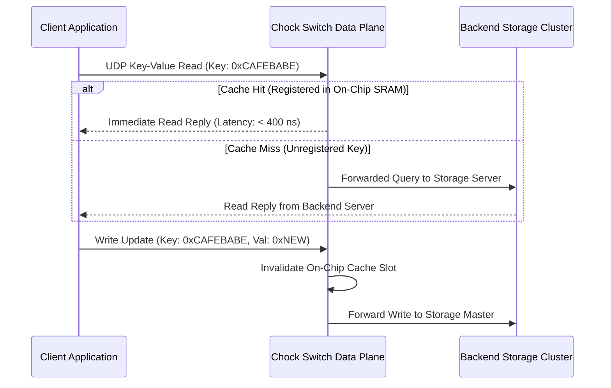

# In-Network Compute Acceleration Architecture

Chock includes hardware primitives for accelerating distributed systems and high-frequency financial workloads directly inside the switch forwarding pipeline.

## NetCache: In-Network Key-Value Storage

NetCache exploits on-chip switch SRAM to serve hot read queries at line rate with sub-microsecond latency, shielding backend storage clusters from skewed key access patterns (Zipfian distributions).

### Cache Slot Structure
Chock manages 16,384 on-chip cache slots indexed via 14-bit CRC32 hash:
- `cache_keys[16384]`: 64-bit key register.
- `cache_values[16384]`: 128-bit value register.
- `cache_valid[16384]`: 1-bit validity flag.
- `cache_frequency[16384]`: 32-bit access counter for hot-key replacement detection.

## NetPaxos: In-Network Consensus Sequencer

NetPaxos offloads consensus sequence numbering into the switch data plane:
1. When Phase 2A (Propose) messages traverse the switch, the hardware verifies that the proposed ballot round matches or exceeds the highest round seen.
2. The switch atomically increments an on-chip monotonic counter in a single clock cycle.
3. Stamps the assigned sequence number directly into the packet header before packet replication to quorum acceptor nodes.

This guarantees total order delivery before packets arrive at server network interfaces.

## Financial Market Data A/B Feed Arbitration

In electronic trading networks, exchanges publish duplicate market data feeds across separate physical links (Line A and Line B) to ensure zero packet loss.

Chock implements line arbitration in P4:
- Maintains a 256-channel array of `last_forwarded_sequence` registers.
- Inspects incoming sequence numbers on Line A and Line B simultaneously.
- The first packet to arrive updates the channel sequence register and forwards to trading engines with sub-microsecond latency.
- The lagging duplicate arriving on the other link is dropped instantly in hardware without CPU intervention.
