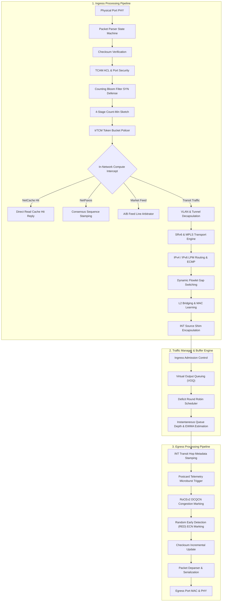
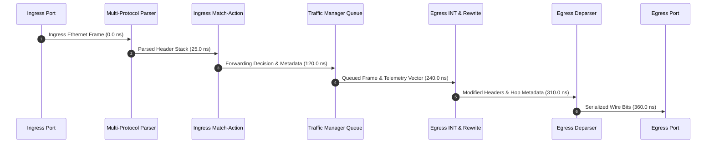

# Chock Architecture Specification

Chock is an ultra high performance programmable network data plane and in-network telemetry engine implemented in P4_16. It couples line-rate L2/L3 forwarding, Segment Routing over IPv6 (SRv6), and overlay virtualization with stateful traffic engineering, in-band telemetry vector stamping, hardware flow sketches, and in-network compute acceleration primitives.

## Pipeline Architecture

The Chock programmable switch architecture partitions data plane execution into distinct, deterministic stages across ingress, traffic management, and egress.



## Memory Hierarchy and Resource Allocation

Chock allocates on-chip hardware memory to optimize pipeline throughput and eliminate lookup stalls.

| Subsystem Component | Hardware Memory Type | Entry Capacity | Key Width | Lookup Latency |
| :--- | :--- | :--- | :--- | :--- |
| Ingress TCAM ACL | Ternary CAM | 8,192 rules | 12-tuple (288 bits) | 1 clock cycle |
| IPv4 FIB LPM | Algorithmic TCAM / Trie | 65,536 prefixes | 32-bit CIDR | 1 clock cycle |
| IPv6 FIB LPM | Algorithmic TCAM | 32,768 prefixes | 128-bit CIDR | 1 clock cycle |
| L2 Forwarding (FDB) | Hash-based SRAM | 16,384 entries | 60 bits (VLAN + MAC) | Single access |
| SRv6 SID Table | Hash-based SRAM | 8,192 entries | 128 bits | Single access |
| VXLAN / VNI Map | Hash-based SRAM | 4,096 entries | 24 bits | Single access |
| Flowlet Hash Table | Dual-ported SRAM | 65,536 flows | 16-bit CRC32 | Single access |
| Count-Min Sketch | 4x Multi-bank SRAM | 4 x 65,536 cells | 32-bit polynomial | Single access |
| Counting Bloom Filter | 2x Multi-bank SRAM | 2 x 65,536 bins | 16-bit Murmur3 | Single access |
| NetCache Storage | On-chip SRAM Registers | 16,384 slots | 64-bit key, 128-bit val | Single access |
| RoCEv2 QP Counters | Dual-ported SRAM | 65,536 queues | 24-bit QP ID | Single access |

## Latency Budget and Clock Cycles

At line rate (e.g., 400 Gbps to 3.2 Tbps per ASIC pipe), packet arrival interval is approximately 1.2 nanoseconds for 64-byte minimum frames. Chock maintains a deterministic execution latency of under 400 nanoseconds across the entire pipeline:



## Checksum Recalculation Semantics

In accordance with RFC 1624, Chock avoids full packet rescans by calculating incremental checksum updates in P4 registers:

```
HC' = ~(~HC + ~m + m')
```

Where `HC` is the original checksum, `m` is the original field value (e.g. TTL or IPv4 address), and `m'` is the updated value. This guarantees zero-cost checksum adjustments in single-cycle ALU stages.
