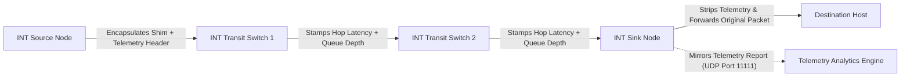

# In-Band Network Telemetry (INT v2.1) Specification in Chock

Chock implements the In-Band Network Telemetry (INT) Metadata Specification v2.1 and Postcard Telemetry (INT-XD). Telemetry enables full line-rate observability into queuing delay, buffer occupancy, and routing paths without software probe packets.

## INT Architecture

## Header Layouts

### 1. INT Shim Header (4 Bytes)
Placed between the transport layer (TCP/UDP) or tunnel encapsulation and the telemetry stack.
- `Type (4 bits)`: 0x1 for INT-MD (Metadata), 0x2 for INT-XD (eXport Drop).
- `NPT (2 bits)`: Next Protocol Type.
- `Length (8 bits)`: Total telemetry header length in 4-byte words.
- `Next Proto (16 bits)`: Original encapsulated L4 protocol number.

### 2. INT Metadata Header (8 Bytes)
- `Version (4 bits)`: 0x2 for INT v2.1.
- `Replication (2 bits)`: Copy policy on packet replication.
- `Flags (3 bits)`: C (Congestion experienced), E (Buffer drop error), M (Mirror requested).
- `Hop Limit (8 bits)`: Maximum allowed telemetry hops before dropping or freezing stack.
- `Remaining Hop Count (8 bits)`: Decremented at each transit switch.
- `Instruction Mask (16 bits)`: Bitmask selecting which local telemetry metrics to stamp.
- `Domain Specific ID (16 bits)`: Tenant or network administrative domain identifier.

## Instruction Mask Vector Mapping

| Bit Offset | Identifier | Stamped Metric Field | Bit Width |
| :--- | :--- | :--- | :--- |
| Bit 15 | `INT_INS_SWITCH_ID` | Global Unique Switch Chassis Identifier | 32 bits |
| Bit 14 | `INT_INS_PORTS` | Ingress Port (9 bits) + Egress Port (9 bits) | 32 bits |
| Bit 13 | `INT_INS_HOP_LATENCY` | Residence queuing latency in nanoseconds | 32 bits |
| Bit 12 | `INT_INS_QUEUE_OCCUPANCY` | Instantaneous queue depth + queue ID | 32 bits |
| Bit 11 | `INT_INS_INGRESS_TS` | Ingress MAC arrival timestamp (nanoseconds) | 64 bits |
| Bit 10 | `INT_INS_EGRESS_TS` | Egress MAC departure timestamp (nanoseconds) | 64 bits |
| Bit 9 | `INT_INS_CONGESTION` | ECN marking, DCQCN CNP status, buffer watermark | 32 bits |
| Bit 8 | `INT_INS_TX_UTIL` | Port bandwidth utilization moving average | 32 bits |

## Postcard Telemetry (INT-XD) Triggering

For out-of-band telemetry, transit nodes do not inflate transit packet headers. Instead, when instantaneous queue occupancy exceeds a configured watermark (e.g. 1,000 packets) or when packet drop events occur:
1. The hardware clones packet metadata and header prefixes.
2. Formats a compact 32-byte postcard notification packet.
3. Dispatches the notification directly to analytics engines over an isolated control port.
